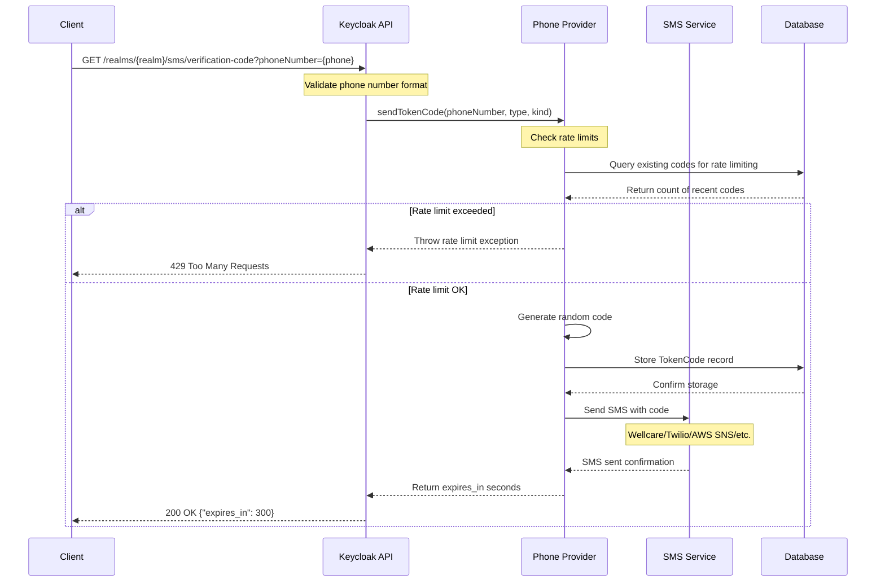
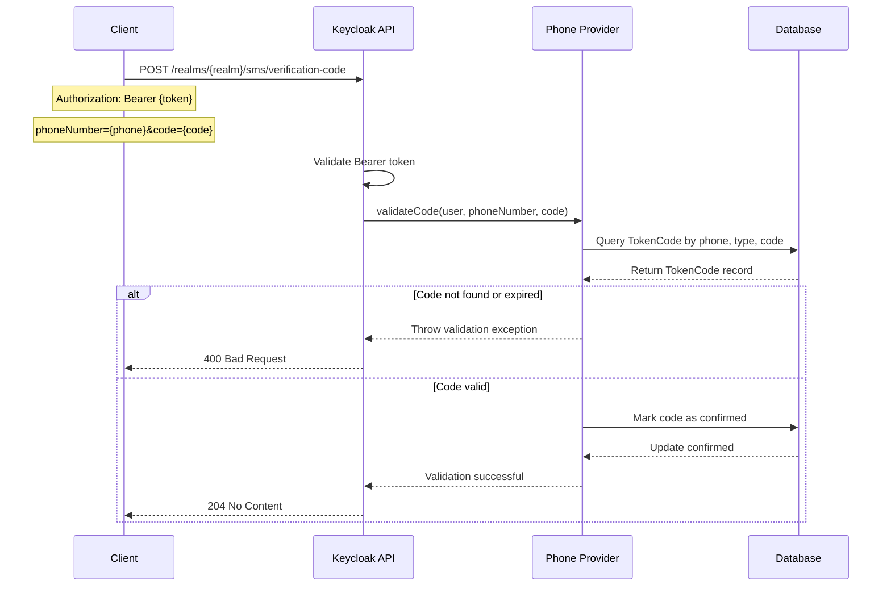
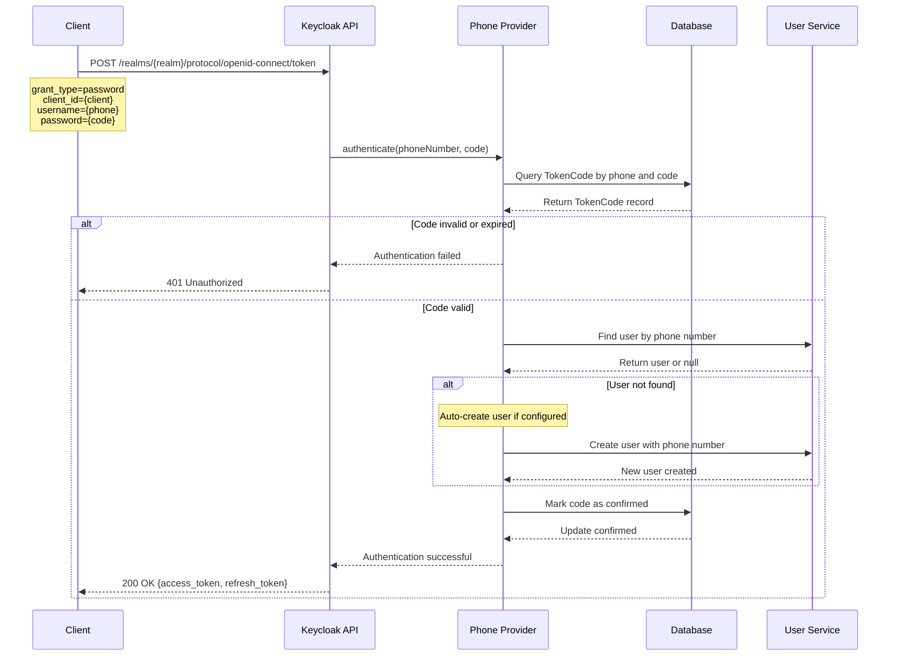
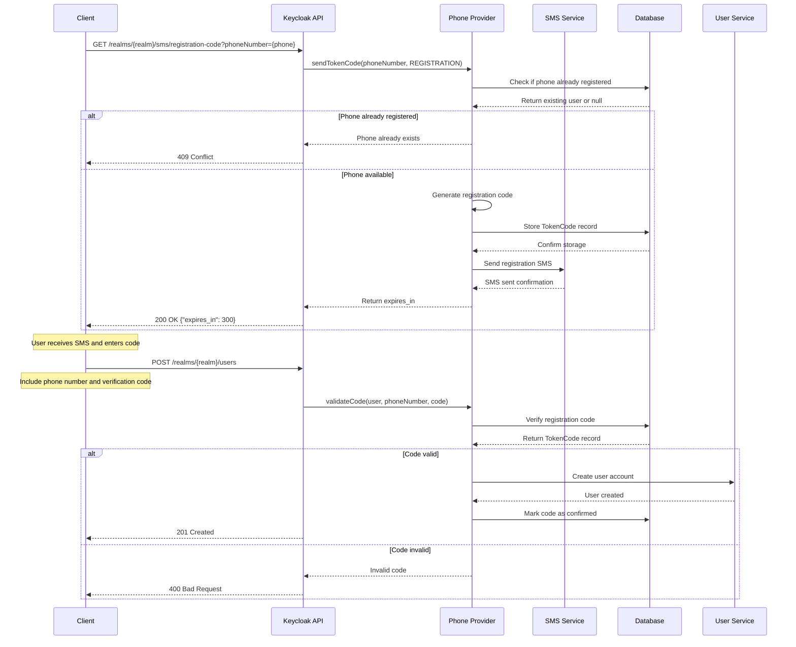
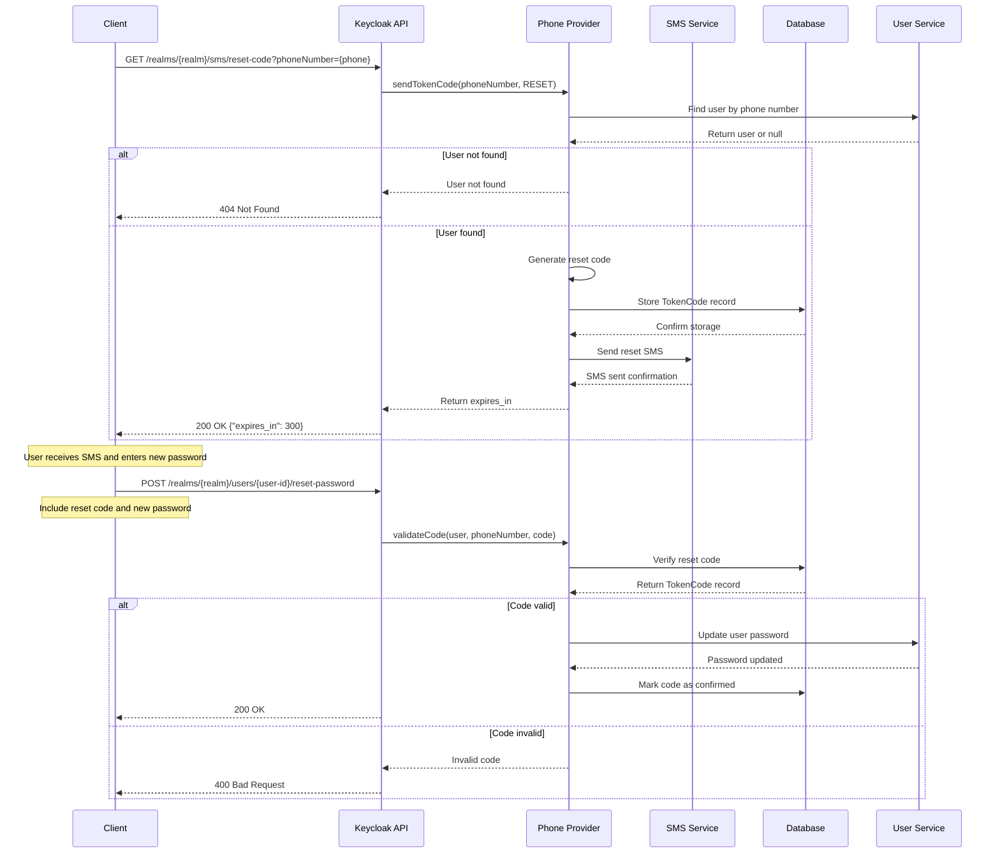
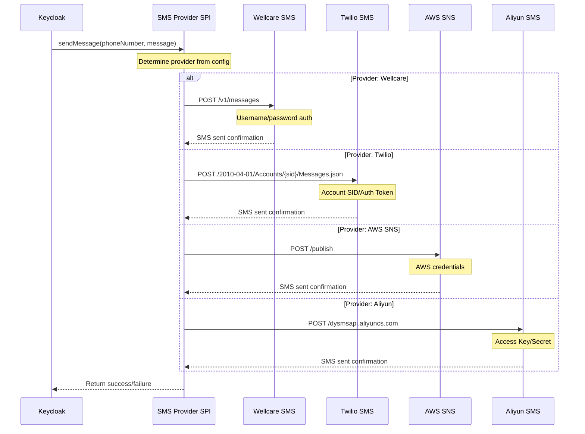

# System Workflows

This document describes the key system workflows and interactions between services using **Mermaid.js** sequence diagrams.

## Overview

The Keycloak Wellcare system integrates with multiple SMS providers and handles various authentication flows. This document covers the confirmed workflows found in the codebase.

## SMS Code Request Flow

This workflow shows how a user requests an SMS verification code through the REST API.

## SMS Code Verification Flow

This workflow shows how a user verifies an SMS code they received.

## Phone Authentication Flow

This workflow shows the direct grant authentication using phone number and SMS code.

## User Registration with Phone Flow

This workflow shows how a user registers with phone number verification.

## Password Reset with Phone Flow

This workflow shows how a user resets their password using phone verification.

## SMS Provider Integration Flow

This workflow shows how the system integrates with different SMS providers.

## Configuration Sources

The system uses the following configuration sources that affect the workflows:

### Environment Variables

- `KK_TO_RMQ_URL`: RabbitMQ connection URL (configured but not used in current codebase)
- `KK_TO_RMQ_PORT`: RabbitMQ port
- `KK_TO_RMQ_EXCHANGE`: RabbitMQ exchange name
- `KK_TO_RMQ_USERNAME`: RabbitMQ username
- `KK_TO_RMQ_PASSWORD`: RabbitMQ password
- `KK_TO_RMQ_USE_TLS`: RabbitMQ TLS flag

### SMS Provider Configuration

- `--spi-phone-default-service`: Default SMS provider (wellcare, twilio, aws-sns, etc.)
- `--spi-message-sender-service-{provider}-username`: Provider username
- `--spi-message-sender-service-{provider}-password`: Provider password
- `--spi-message-sender-service-{provider}-url`: Provider API URL
- `--spi-message-sender-service-{provider}-from`: Sender identifier

### Rate Limiting Configuration

- `--spi-phone-target-hour-maximum`: Maximum codes per hour per phone
- `--spi-phone-source-hour-maximum`: Maximum codes per hour per IP
- `--spi-phone-otp-expires`: OTP expiration time in seconds

## Error Handling

All workflows include comprehensive error handling:

1. **Rate Limiting**: Returns 429 Too Many Requests when limits exceeded
2. **Invalid Phone Numbers**: Returns 400 Bad Request for malformed numbers
3. **Expired Codes**: Returns 400 Bad Request for expired verification codes
4. **Authentication Failures**: Returns 401 Unauthorized for invalid credentials
5. **User Not Found**: Returns 404 Not Found when phone number not registered
6. **Duplicate Registration**: Returns 409 Conflict for existing phone numbers
7. **SMS Provider Errors**: Returns 500 Internal Server Error for SMS service failures
