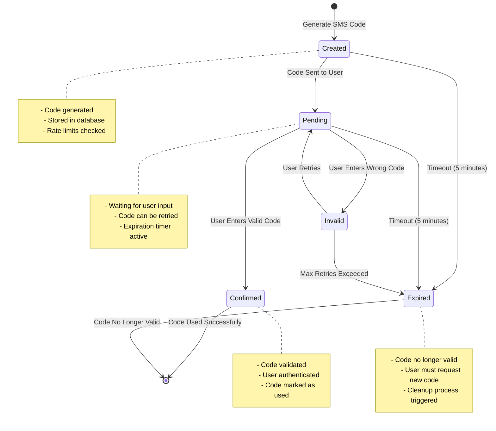
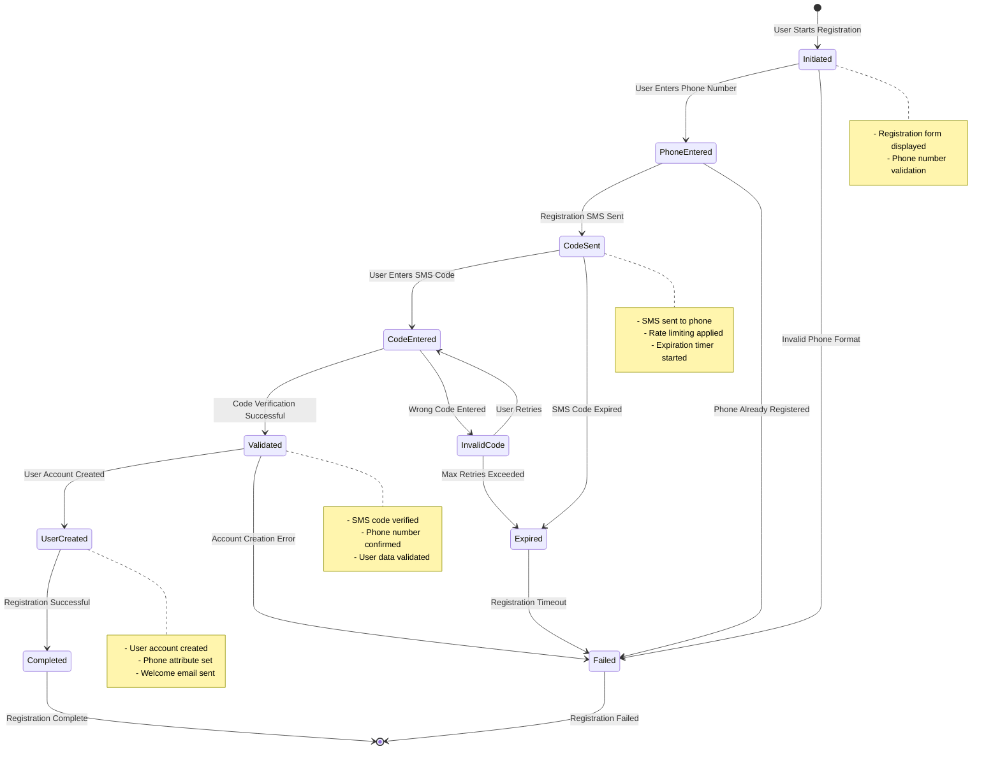
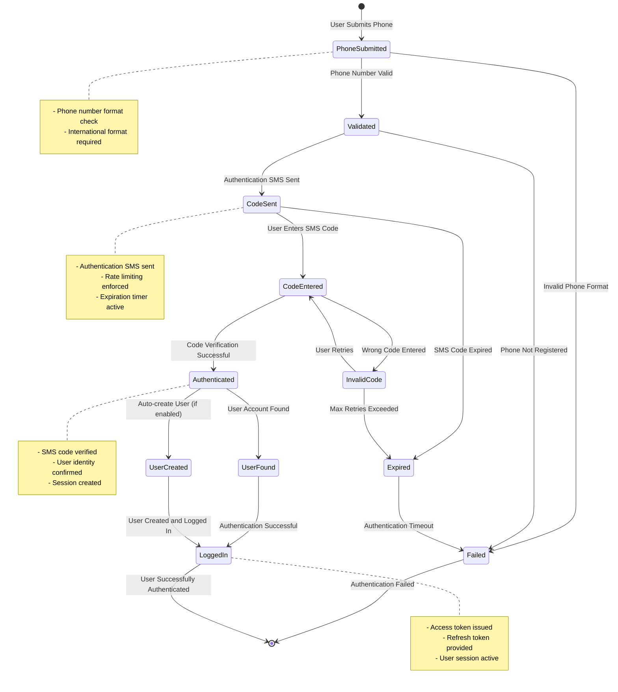
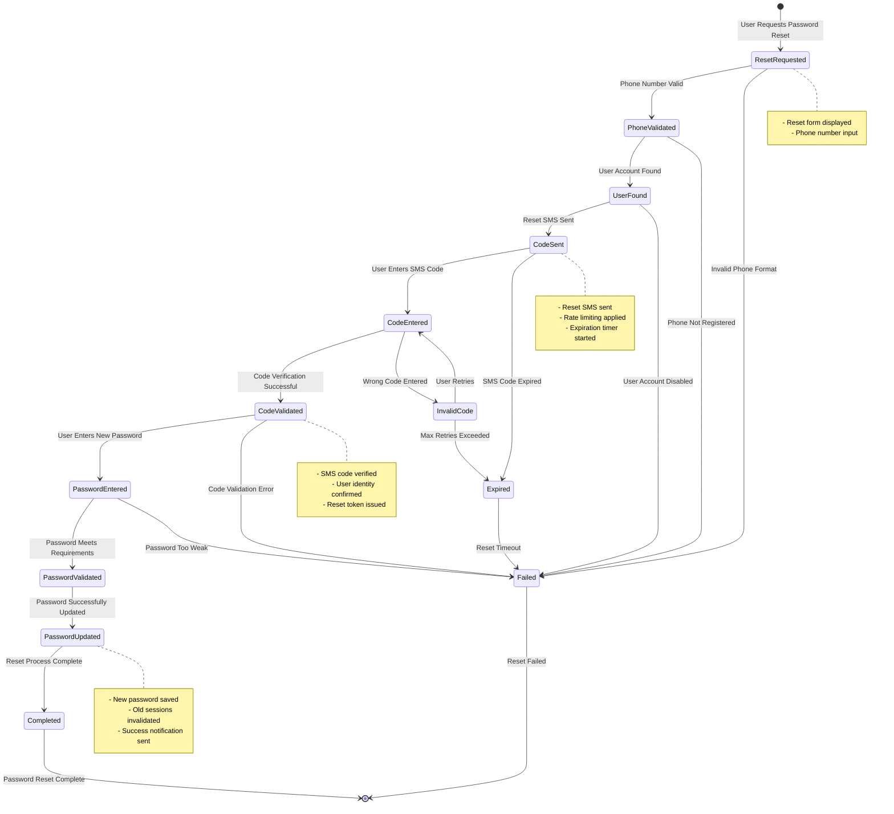
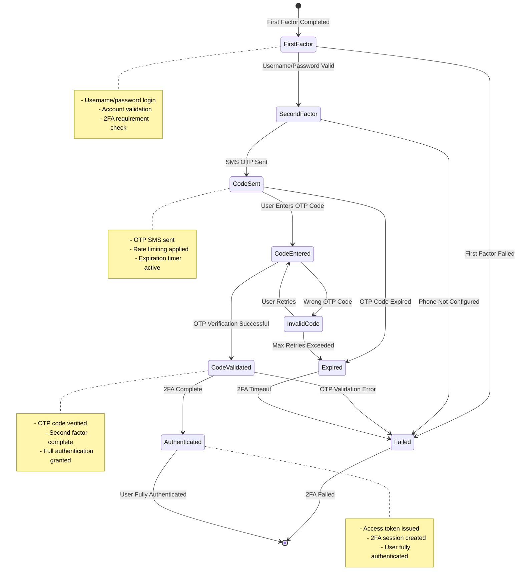

# State Machines

This document describes the state machines and authentication flows in the Keycloak Wellcare system using **Mermaid.js** state diagrams.

## Overview

The system implements several state machines for different authentication scenarios. Each state machine represents a specific authentication flow with defined states, transitions, and triggers.

## SMS Token Code State Machine

This state machine tracks the lifecycle of SMS verification codes from creation to expiration or confirmation.

## User Registration State Machine

This state machine tracks the user registration process with phone verification.

## Phone Authentication State Machine

This state machine tracks the phone-based authentication flow.

## Password Reset State Machine

This state machine tracks the password reset process using phone verification.

## Two-Factor Authentication (2FA) State Machine

This state machine tracks the SMS-based two-factor authentication flow.

## State Transitions Table

| Trigger            | From State      | To State  | Conditions                   |
| ------------------ | --------------- | --------- | ---------------------------- |
| Generate Code      | [*]             | Created   | Rate limit not exceeded      |
| Send SMS           | Created         | Pending   | SMS provider available       |
| Timeout            | Created/Pending | Expired   | 5 minutes elapsed            |
| Enter Valid Code   | Pending         | Confirmed | Code matches and not expired |
| Enter Invalid Code | Pending         | Invalid   | Code doesn't match           |
| Retry Code         | Invalid         | Pending   | Under max retry limit        |
| Max Retries        | Invalid         | Expired   | Retry limit exceeded         |
| Use Code           | Confirmed       | [*]       | Code consumed                |
| Cleanup            | Expired         | [*]       | Expired code removed         |

## State Metadata

Each state includes the following metadata:

### Timestamps

- `created_at`: When the state was first entered
- `updated_at`: When the state was last modified
- `expires_at`: When the state will expire (if applicable)

### User Context

- `user_id`: Associated user (if applicable)
- `phone_number`: Phone number involved in the flow
- `ip_address`: Client IP address for security tracking

### Security Information

- `session_id`: Associated session identifier
- `correlation_id`: Request correlation for tracing
- `rate_limit_key`: Key used for rate limiting

## Error Handling

Each state machine includes comprehensive error handling:

1. **Timeout Handling**: Automatic transition to failed/expired states
2. **Rate Limiting**: Prevention of state transitions when limits exceeded
3. **Invalid Input**: Graceful handling of malformed requests
4. **Provider Failures**: Fallback mechanisms for SMS service failures
5. **Database Errors**: Rollback mechanisms for failed state persistence

## Security Considerations

1. **State Validation**: All state transitions are validated for security
2. **Session Management**: Proper session handling throughout state changes
3. **Audit Logging**: All state transitions are logged for security monitoring
4. **Rate Limiting**: Prevents abuse of state transition triggers
5. **Expiration**: Automatic cleanup of expired states to prevent resource exhaustion
